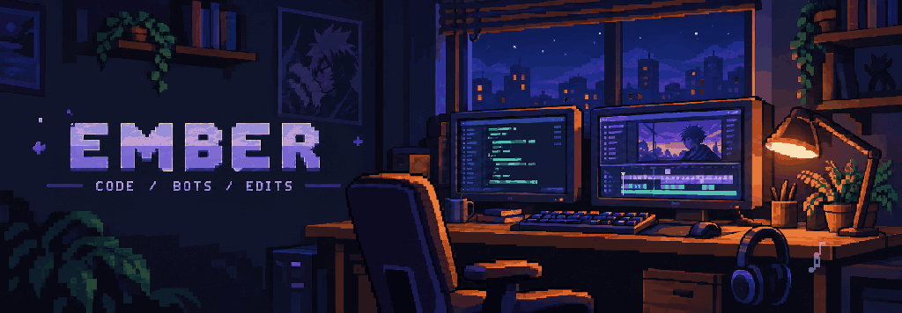
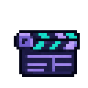

 I'm Ember. I build Discord bots and web interfaces, mostly with TypeScript and React.

  
  
  
  
  
  
  
  

###  

<!-- PROJECTS:START -->
   Discord moderation with custom permissions, cases, and server logs.
<!-- PROJECTS:END -->

###  

I make movie and anime edits in After Effects.

  
  

