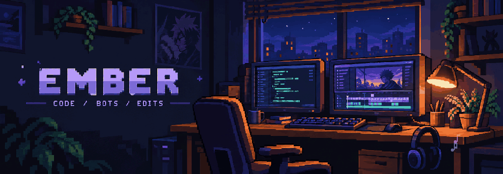
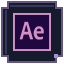
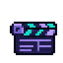
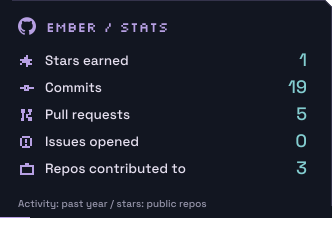
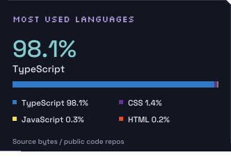
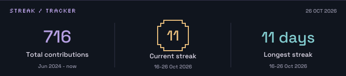

  <picture>
    <source media="(max-width: 480px)" srcset="assets/about-mobile-v7.svg">
    
  </picture>

  
  
  
  
  
  
  
  

###  

  Discord moderation with custom permissions, cases, and server logs.

###  

I make movie and anime edits in After Effects.

  
  

  
  

  <a href="https://github.com/gogeta1232?tab=overview">
    <picture>
      <source media="(max-width: 480px)" srcset="assets/stats-streaks-mobile-v6.svg">
      
    </picture>
  </a>

